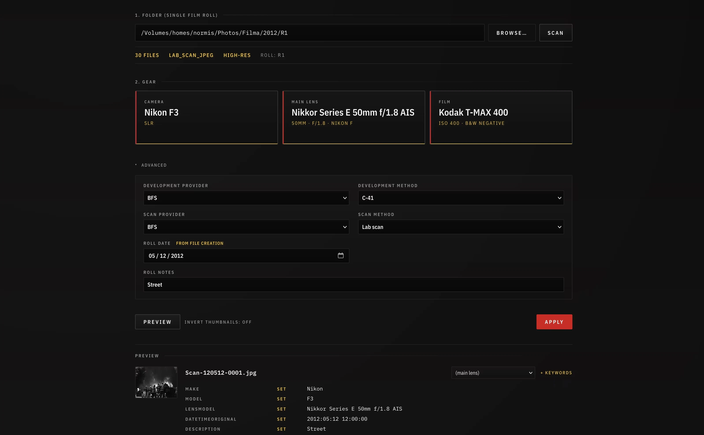

# FilmEx

FilmEx (Film EXIF) is a desktop app for tagging folders of film scans with
the analog camera, lens and film they came from, before the scans go into
Lightroom or any other DAM. It is local-first: ExifTool runs on your
machine, your folders stay where they are, nothing leaves the computer.


_Main tagging workflow_

## Install

Pick one:

- **macOS app.** Download `FilmEx-<version>-arm64.dmg` from the
  [releases page](https://github.com/trakais/FilmEx/releases) and drag
  `FilmEx.app` to Applications. The app is not notarized (no
  paid Apple developer account), so the first launch is blocked: open it
  once, then go to System Settings ▸ Privacy & Security and click **Open
  Anyway**. Or clear the quarantine flag instead, once per downloaded
  version:

  ```bash
  xattr -dr com.apple.quarantine /Applications/FilmEx.app
  ```
- **Installed tool, any platform.** Needs [`uv`](https://docs.astral.sh/uv/);
  it installs Python itself. `filmex` then opens the window.

  ```bash
  uv tool install "filmex @ git+https://github.com/trakais/FilmEx.git"
  filmex
  ```
- **From a checkout.** `uv sync` once, then `uv run filmex`.

ExifTool must be installed (`brew install exiftool` on macOS). FilmEx finds
it on `PATH`, in the usual Homebrew locations, or at the path set in
Settings ▸ Preferences.

## What it does

- opens a folder of scans and shows its frames on a contact sheet
- detects `JPG`, `TIFF`, `DNG` and `ARW`, and keeps a raw file, its JPEG,
  its `.xmp` sidecar and its `.thm` thumbnail together as one frame
- lets you pick the camera, lens and film from your own gear lists, with
  film brands as a separate list that carries each brand's colours
- adds development and scan provider and method, roll date, place, notes
- shows exactly what will be written to every file before writing it, with
  per-file lens overrides and extra keywords
- writes with ExifTool: XMP sidecars (`photo.xmp`) for raw files, embedded
  metadata for `JPG` and `TIFF`; re-applying never duplicates a keyword
- leaves a `roll_manifest.json` beside the images
- splits a scan session into one folder per roll, imports rolls from a card
  into a library with copy-and-verify, renames roll folders to one naming
  scheme, and can undo each of those batches

## How it works

Open a folder of scans: drop it on the window, press Open folder, or pick
it from the recent list. Its frames appear on a contact sheet as one roll.
Pick the camera, lens and film, check the date, and press Write. That tags
the files where they are and leaves a `roll_manifest.json` beside them.

The same screen covers the rest:

- **More than one roll in the folder.** FilmEx suggests where rolls change
  from pauses in the capture times (weighed by how many frames a roll
  holds), restarting file numbers and changes of frame shape, and shows
  each seam side by side so you can confirm it. Or select the first frame
  of the next roll and press "Cut here" (the C key), or build a roll from
  a selection. Each roll gets its own gear, film, date and folder name
  from the template. "Keep here" then splits the folder into one folder
  per roll.
- **A library.** Choose a library folder once (the top folder with year
  folders inside). The Library becomes the start screen: every roll by
  year with its status, counts, film and camera, with Tag, Tag remaining,
  Open and Reveal on each row. The index is cached, so it opens even when
  the share is unmounted.
- **Importing.** With a library set, a folder opened from anywhere else
  offers "Copy to library" and "Move to library". Rolls land in
  `<root>/<year>/<name>`, every file is read back and verified before a
  source is ever deleted, and each new folder is tagged on the spot. The
  plan is shown before anything runs, and the last batch can be undone.
- **Changes** on a roll card shows exactly what will be written to each
  file, with a per-file lens override and extra keywords.
- **Normalize names** (Library menu) proposes a folder name for every
  tagged roll from the template in Settings ▸ Preferences, renames in
  place, updates the manifest and the `Roll|` keyword on every tagged
  file, and can undo the batch.

Raw files and their JPEGs, sidecars and `.thm` thumbnails always travel
together. Files that belong to no frame, such as notes, stay behind.

## Where things live

- The app's database (gear, films, providers, settings, recent folders,
  the library index, the undo journal) is in the per-user data directory:
  `~/Library/Application Support/FilmEx` on macOS. A source checkout uses
  `data/` instead. `FILMEX_DATA_DIR` overrides both.
- A fresh install starts from a bundled database with sample cameras,
  lenses, films, film brands, providers and methods.
- Each tagged folder carries its own `roll_manifest.json`. Everything
  about a roll that matters later is in that file and in the images'
  metadata, not in the database.

## Browser mode

The window is a thin shell around a local web server, so FilmEx also runs
in an ordinary browser: on Linux and Windows, where there is no app bundle
yet, or whenever you prefer a browser tab.

```bash
./filmex-run          # macOS / Linux
filmex-run.cmd        # Windows
```

This starts the server on `http://127.0.0.1:8765` and opens your browser;
set `FILMEX_PORT` for another port. The server only answers requests from
the same machine. Everything works the same, except that the folder picker
is a text field instead of a native dialog.

## Bulk data entry

To add cameras, lenses, film brands, films, providers or methods in bulk,
for example from an LLM-drafted batch, use the CLI. It is idempotent: rows
that already exist (matched by natural key) are skipped, never
overwritten. `export-json` dumps the live database in the same shape, so it
doubles as a backup and as a way to move gear between installs.

```bash
uv run python -m filmex.cli add-from-json examples/entities-batch.json --dry-run
uv run python -m filmex.cli add-from-json examples/entities-batch.json
uv run python -m filmex.cli add-from-json examples/entities-batch.json --upsert-film-data
uv run python -m filmex.cli export-json -o backup.json
```

See `AGENTS.md` for the batch schema and nomenclature conventions.

## Building the app

```bash
packaging/build-macos.sh
```

Produces `dist/FilmEx.app` and a DMG, ad-hoc signed. To bundle ExifTool
inside the app, run `packaging/fetch-exiftool.sh` first (pin the tarball
checksum in `packaging/exiftool.lock` when prompted). Releases are built
locally.

## Development

Python 3.11+, `uv`, ExifTool on `PATH`.

```bash
uv sync                  # first time only
uv run pytest            # tests
uv run ruff check .      # lint
FILMEX_SMOKE_SECONDS=8 uv run filmex   # open the window, check it, close it
```

`AGENTS.md` at the repo root is the canonical reference for project
conventions: data model, nomenclature, metadata write policy, keyword
taxonomy, and safety rules. Read it before changing behaviour.
