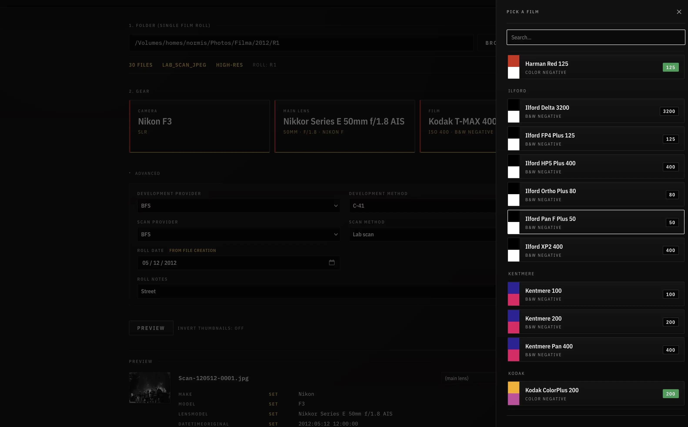

# FilmEx

FilmEx, or Film EXIF, is a local-first browser tool for tagging film scan folders before import into Lightroom or other DAM software. It relies on your system exiftool and local filesystem, so you must run it locally, not in a container or on another machine. 


_Main tagging workflow_

## What It Does

- scans a single film-roll folder
- detects supported files: `JPG`, `TIFF`, `DNG`, `ARW`
- lets you choose analog camera, lens, and film stock
- keeps film brands as a separate controlled list with per-brand colors
- adds development and scan metadata
- lets you add per-file lens overrides and extra keywords in the preview
- stores roll notes as a description/caption field, not as keywords
- shows a dry-run preview before writing anything
- can create lightweight local previews for files that do not already have `.thm` thumbnails
- writes metadata with ExifTool
- creates a `roll_manifest.json` next to the images

For raw files (`DNG`, `ARW`), FilmEx writes to XMP sidecars using the canonical
replaced-extension form like `photo.xmp`.

For `JPG` and `TIFF`, FilmEx writes metadata into the file itself.

## Main Workflow


_Film roll and stock selection_

1. Choose one folder containing a single film roll.
2. Scan the folder.
3. Pick camera, main lens, and film.
4. Add optional development / scan info.
5. Optionally create previews if the folder does not already have thumbnails.
6. Preview the metadata changes and add optional per-file lens overrides or keywords.
7. Add optional roll notes.
8. Apply the changes.

## Requirements

- Python 3.11+
- `uv`
- `exiftool` available on `PATH`

## Run Locally

First time only:

```bash
uv sync
```

Then, on macOS / Linux:

```bash
./filmex-run
```

On Windows:

```cmd
filmex-run.cmd
```

This starts the server on `http://127.0.0.1:8765` and opens your browser. Set
`FILMEX_PORT` to use a different port.

Or run uvicorn directly if you prefer:

```bash
uv run uvicorn filmex.main:app --port 8765
```

## Notes

- The app stores runtime data in `data/`.
- A starter SQLite database is bundled with sample cameras, lenses, films, film brands, providers, and methods.
- Your own working database lives in `data/filmex.sqlite`.
- Temporary and private local files should stay in `tmp/`, which is ignored by git.

## Bulk data entry

To add cameras, lenses, film brands, films, providers, or methods in bulk —
for example from an LLM-drafted batch — use the CLI. It is idempotent: rows
that already exist (matched by natural key) are skipped, never overwritten.

```bash
uv run python -m filmex.cli add-from-json examples/entities-batch.json --dry-run
uv run python -m filmex.cli add-from-json examples/entities-batch.json
uv run python -m filmex.cli add-from-json examples/entities-batch.json --upsert-film-data
uv run python -m filmex.cli export-json -o backup.json
```

See `AGENTS.md` for the batch schema and nomenclature conventions.

## Testing

```bash
uv run pytest
```

## Contributing

`AGENTS.md` at the repo root is the canonical reference for project
conventions: data model, nomenclature, metadata write policy, keyword
taxonomy, and safety rules. Read it before changing behaviour.
